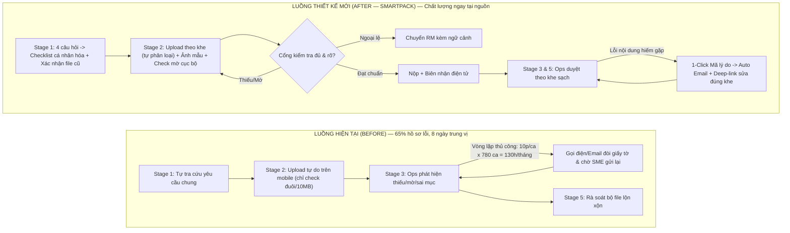

# HACK4BIZ – ROUND 1: TỔNG HỢP CHIẾN LƯỢC GIẢI CASE & PHẦN CREATIVE SERVICE REDESIGN

> **Mục đích tài liệu:** Hệ thống hóa toàn bộ bối cảnh, số liệu quy đổi, ràng buộc và "bẫy" của đề bài Bank X để đội thi giải trọn vẹn cả 4 phần một cách nhất quán; đồng thời cung cấp bài làm hoàn chỉnh, sắc bén cho **Part 2: Creative Service Redesign** (Mô tả giải pháp, Bảng luồng Before vs. After, Giải quyết nguyên nhân gốc rễ).

---

# PHẦN A: THÔNG TIN CẦN THIẾT ĐỂ GIẢI CASE STUDY

## 1. Bối cảnh, Phạm vi & Quy định sống còn

| Hạng mục | Chi tiết từ đề bài | Lưu ý chiến lược khi viết bài |
| :--- | :--- | :--- |
| **Chủ thể & Bối cảnh** | **Bank X** – Ngân hàng thương mại Việt Nam phục vụ cá nhân & SME. Đã số hóa phần lớn quy trình nộp hồ sơ vay SME, nhưng khách hàng vẫn tốn nhiều công sức và vận hành bị quá tải. | Không đề xuất "xây lại hệ thống từ đầu". Phải tái thiết kế dịch vụ dựa trên nền tảng sẵn có. |
| **Phạm vi (Scope)** | **In-scope:** 5 bước đầu của hành trình (1. Tìm hiểu yêu cầu → 2. Chuẩn bị & tải hồ sơ → 3. Kiểm tra đầy đủ → 4. Theo dõi tiến độ → 5. Rà soát hồ sơ ban đầu).<br>**Out-of-scope:** Thẩm định tín dụng chính thức & phê duyệt khoản vay cuối cùng (`Section 2`, `Section 5`). | **Tuyệt đối không** can thiệp vào quy trình/hệ thống phê duyệt tín dụng (Credit approval engine). Không bắt buộc cải thiện cả 5 bước — **chỉ chọn 1 vấn đề ưu tiên nhất**. |
| **Mục tiêu thách thức** | Thiết kế lại trải nghiệm vay SME để giảm nỗ lực thừa cho khách hàng & giảm lãng phí vận hành, triển khai bằng **Scrum** trong **8 tuần (4 Sprints × 2 tuần)** để ra mắt **MVP khả thi** cho đợt **controlled pilot** sau Sprint 4. | Mọi khuyến nghị ở cả 4 phần phải xoay quanh **cùng 1 vấn đề & 1 giải pháp duy nhất**. |
| **Quy cách nộp bài** | 1 file `.docx` (≤ 5 MB), **tối đa 6 trang** (quá trang 6 không chấm). Khổ A4, Times New Roman 12pt, giãn dòng 1.5, lề 2–2.5 cm (bảng dùng single spacing, 10–11pt). Không dùng video/GIF/embedded object. Không có Appendix. Cite inline (`Exhibit A`, `Section 6`). Thời gian làm bài: 120 phút. | **Phân bổ 6 trang tối ưu:**<br>- Part 1: ~0.75–1 trang<br>- Part 2: ~1.75–2 trang<br>- Part 3: ~2 trang (dùng bảng gọn)<br>- Part 4: ~1–1.25 trang |

---

## 2. Dữ liệu vận hành & Các chỉ số quy đổi bắt buộc dùng để lập luận

Tất cả số liệu đại diện cho **1 tháng điển hình** tại Bank X (`Section 4`):

### Bảng tổng hợp dữ liệu gốc & Quy đổi tác động

| Nhóm dữ liệu | Chỉ số gốc (Nguồn) | Số liệu quy đổi / Insight chiến lược |
| :--- | :--- | :--- |
| **Quy mô & Tỷ lệ lỗi hồ sơ** | • 1,200 hồ sơ/tháng (`Exhibit A`)<br>• **780 hồ sơ (65%)** cần liên hệ bổ sung giấy tờ thiếu/sai (`Exhibit A`)<br>• SME vay lần đầu: 800 hồ sơ, **75%** cần bổ sung (`Exhibit B`)<br>• SME quay lại: 400 hồ sơ, **45%** cần bổ sung (`Exhibit B`) | • **600 hồ sơ lỗi** đến từ SME lần đầu (chiếm **76.9%** tổng số ca phải follow-up).<br>• **180 hồ sơ lỗi** vẫn xảy ra ở nhóm SME đã có kinh nghiệm → lỗi mang tính hệ thống, không chỉ do khách hàng mới bỡ ngỡ. |
| **Lãng phí nhân sự Follow-up** | • 10 phút/lần follow-up (liên hệ + kiểm tra lại) (`Exhibit A`)<br>• 68% ca lỗi được sửa trong 1 ngày làm việc (`Exhibit A`) | • **780 × 10 phút = 7,800 phút = 130 giờ nhân công/tháng** (tương đương gần 1 nhân sự toàn thời gian chỉ để đi đòi và check lại giấy tờ).<br>• **32% (~250 hồ sơ/tháng)** mất hơn 1 ngày làm việc để hoàn tất bổ sung. |
| **Tác động lên thời gian xử lý** | • Trung vị toàn bộ: **7 ngày làm việc**<br>• Không cần follow-up: **4 ngày làm việc**<br>• Có follow-up: **8 ngày làm việc** (`Exhibit A`) | • Hồ sơ phải bổ sung bị kéo dài **gấp đôi (+4 ngày làm việc / +100% thời gian chờ)**.<br>• *Lưu ý:* Đề ghi rõ có thể còn yếu tố khác ảnh hưởng nên đây là **giả định cần kiểm chứng**, không khẳng định chắc chắn tiết kiệm trọn vẹn 4 ngày. |
| **Kênh & Định dạng tài liệu** | • **78%** hồ sơ khởi tạo trên **điện thoại** (`Exhibit A`)<br>• **41%** tài liệu tải lên là **ảnh chụp hoặc bản scan** (`Exhibit D`)<br>• Định dạng chấp nhận: PDF, JPG/JPEG, PNG ≤ 10 MB (`Section 5`) | • **~936 hồ sơ/tháng** bắt đầu trên mobile.<br>• Giải pháp **bắt buộc phải Mobile-First** và xử lý trực diện rủi ro ảnh chụp mờ/thiếu góc/sai trang của 41% tài liệu dạng hình ảnh. |
| **Hỏi thăm tiến độ (Stage 4)** | • 400 lượt hỏi trạng thái/tháng; 5 phút/lượt (`Exhibit C`)<br>• 26% là hỏi lặp lại trong 7 ngày (`Exhibit C`)<br>• 21/25 người khảo sát muốn nhận thông báo chủ động (`Exhibit C`)<br>• Trạng thái đồng bộ ra portal **1 lần/ngày** (`Section 5`) | • Tổng công sức xử lý: **400 × 5 phút = 33.3 giờ/tháng** (chỉ bằng **~1/4** so với 130 giờ của follow-up thiếu hồ sơ).<br>• 104 lượt hỏi lặp lại/tháng. |
| **Rà soát ban đầu (Stage 5)** | • 12 phút/hồ sơ → **240 giờ/tháng** (`Exhibit D`)<br>• 35% thời gian dành cho nhập liệu thủ công (`Exhibit D`)<br>• Prototype AI phân loại đạt 96% (48/50 file) (`Exhibit D`) | • Nhập liệu thủ công tốn **84 giờ/tháng** (4.2 phút/hồ sơ).<br>• Tuy nhiên, AI chưa từng kiểm thử trên 41% file scan/ảnh chụp thực tế → **rủi ro kỹ thuật & phê duyệt cực cao**. |

---

## 3. Các "Bẫy" đề bài & Ràng buộc thực thi (Phải tránh để ghi điểm tối đa)

1. **Bẫy "Hype AI" (`Exhibit D`, `Section 5`, `Section 6`, `Section 7`):**
   - Prototype AI mới chỉ test trên 50 file kỹ thuật số "sạch", chưa thử nghiệm với ảnh chụp/scan (41%), file hỏng hay hồ sơ thiếu.
   - Mọi tích hợp AI production hoặc dịch vụ bên thứ 3 đều cần duyệt bảo mật/tuân thủ từ lãnh đạo và **không đảm bảo được duyệt trong 8 tuần**.
   - **Bài học:** Không đặt cược MVP 8 tuần vào AI OCR/AI Chatbot. Đề thi nhấn mạnh: *"Creativity will be evaluated based on the solution's relevance, effectiveness, and ability to address the identified problem, rather than the technology used."*
2. **Bẫy "Số liệu nhiễu & Mẫu khảo sát nhỏ" (`Exhibit C`):**
   - `21,000 sessions/tháng` là lượt truy cập mobile banking của **tất cả dịch vụ**, không phải riêng SME vay vốn → **tuyệt đối không dùng làm bằng chứng ưu tiên**.
   - Khảo sát `21/25` muốn nhận notification là mẫu tiện lợi (convenience sample), không đủ tính đại diện → nếu nhắc tới phải chỉ ra hạn chế này.
3. **Bẫy "Nhân lực & Thời gian cố định" (`Section 6`):**
   - Đội Scrum cố định: **1 PO, 1 SM, 2 Dev (FT), 1 QA (chỉ 50% = ~5 ngày công/Sprint), 1 BA (FT)**.
   - Nhân sự nghiệp vụ (RM & Credit Ops) chỉ rảnh **tối đa 2 giờ/tuần tổng cộng** để tư vấn, phản hồi và test → phải tận dụng cực kỳ kỷ luật (ví dụ: dùng thời lượng này cho Usability session, review bộ quy tắc tài liệu, và Sprint Review).
   - Bắt buộc hoàn thành **Security Review & Critical Functionality Testing** ngay trong 8 tuần trước khi chạy pilot.
4. **Ràng buộc hạ tầng & bảo mật (`Section 5`, `Section 6`):**
   - Tận dụng hệ thống sẵn có: Online portal (đã có đăng nhập, lưu nháp cơ bản, upload file), kho lưu trữ tài liệu bảo mật, ma trận quy tắc hồ sơ nội bộ, email giao dịch (transactional emails).
   - Tài liệu khách hàng **bắt buộc nằm trong môi trường được phê duyệt**, không đẩy ra API AI ngoài. Kênh thông báo mới (SMS/Zalo/Push) cần thẩm định thêm → MVP nên ưu tiên **Transactional Email sẵn có + In-portal UI**.

---

## 4. Sợi chỉ đỏ liên kết cả 4 phần của bài nộp

Để cả 4 phần thống nhất như một bản đề xuất thực thụ:

- **Part 1 – Vấn đề ưu tiên & Product Goal:**
  - **Vấn đề ưu tiên (Stage 1 → 2 → 3):** Tỷ lệ hồ sơ vay SME bị thiếu, mờ hoặc phân loại sai quá cao (**65% toàn bộ; 75% ở SME vay lần đầu**), khiến nhân sự tốn **130 giờ/tháng** để liên hệ bổ sung và đẩy trung vị thời gian xử lý từ **4 lên 8 ngày làm việc** (`Exhibit A`, `Exhibit B`).
  - **Vì sao chọn vấn đề này (thay vì Stage 4 hay Stage 5)?** Tác động định lượng lớn nhất (130 giờ vs. 33.3 giờ ở Stage 4), ảnh hưởng trực tiếp tới 65% khách hàng, tạo hiệu ứng lan tỏa tích cực cho cả Stage 4 & 5, và giải quyết khả thi trong 8 tuần mà **không phụ thuộc phê duyệt AI**.
  - **Product Goal đề xuất:** *"Giúp khách hàng SME (đặc biệt là SME vay lần đầu trên thiết bị di động) nộp bộ hồ sơ tín dụng đầy đủ, rõ nét và đúng danh mục ngay từ lần đầu tiên, qua đó giảm mạnh tỷ lệ phải yêu cầu bổ sung hồ sơ và cắt giảm công việc xử lý lặp lại trước khi đưa vào kiểm thử pilot sau 8 tuần."*
  - **Giả định quan trọng cần kiểm chứng (Key Assumption):** Việc chuẩn hóa hướng dẫn và kiểm tra hồ sơ trước khi nộp trên mobile sẽ thực sự làm giảm tỷ lệ hồ sơ phải bổ sung (và giảm thời gian xử lý), tức là nguyên nhân chính đến từ sự thiếu rõ ràng của quy trình nộp chứ không phải do SME thực sự không sở hữu giấy tờ tại thời điểm đăng ký.
- **Part 2 – Creative Service Redesign:** Giải pháp **"SmartPack"** (chi tiết đầy đủ ở **Phần B** bên dưới).
- **Part 3 – Scrum MVP (4 Sprints × 2 tuần):**
  - *Sprint 1:* Bộ lọc hồ sơ động (Rule-based Checklist) cho 1–2 sản phẩm vay SME phổ biến nhất + Giao diện tải lên theo từng khe tài liệu (Slot-based Upload) trên portal sẵn có.
  - *Sprint 2:* Hướng dẫn ảnh mẫu Đúng/Sai + Kiểm tra chất lượng ảnh cục bộ trên thiết bị (Client-side check) + Cổng kiểm tra đầy đủ trước khi nộp (Pre-submission Readiness Gate) → Demo & Usability test cuối Sprint 2.
  - *Sprint 3:* Tối ưu UX điều hướng hành động kế tiếp (xử lý trực tiếp phát hiện 5/8 người dùng bối rối ở Section 7) + Giao diện Credit Ops duyệt theo khe & chọn mã lý do từ chối chuẩn hóa.
  - *Sprint 4:* Vòng lặp bổ sung 1 chạm qua Transactional Email + Deep-link, chỉ báo tái sử dụng giấy tờ cho SME quay lại, hoàn tất Security Review & Critical Functionality Testing để sẵn sàng Pilot.
- **Part 4 – Ứng phó Sprint 2 Review (`Section 7`):**
  - *Tình huống 1 (5/8 người dùng không hiểu bước tiếp theo):* Không phớt lờ cũng không đại tu mù quáng — PO đưa task **cải thiện micro-copy, nút hành động chính (CTA) & kiểm chứng nhanh lại với nhóm người dùng mới** lên đầu ưu tiên Sprint 3, vì nếu UX khó hiểu, toàn bộ Product Goal (giảm lỗi nộp hồ sơ) sẽ thất bại.
  - *Tình huống 2 (Lãnh đạo yêu cầu thêm AI Assistant trước pilot):* PO **từ chối đưa vào phạm vi MVP 8 tuần**, giải thích dựa trên dữ liệu và ràng buộc: (1) Không nằm trong Product Goal ban đầu, (2) Rủi ro không kịp phê duyệt bảo mật/AI trong 2 Sprint còn lại (`Section 6`), (3) Tranh chấp nguồn lực của 2 Dev & 0.5 QA đang cần sửa lỗi UX cốt lõi. Đề xuất đưa vào **Post-MVP Product Backlog** để đánh giá sau kết quả Pilot.

---

# PHẦN B: CREATIVE SERVICE REDESIGN (PART 2)

> **Bối cảnh gắn kết Part 1:** Thiết kế lại trải nghiệm nộp và hoàn thiện hồ sơ vay SME (tập trung vào **Giai đoạn 1, 2 và 3**) nhằm triệt tiêu tỷ lệ **65% hồ sơ phải bổ sung** (`Exhibit A`), đặc biệt ở nhóm **SME vay lần đầu (75% lỗi)** (`Exhibit B`) và **78% hồ sơ khởi tạo trên di động** (`Exhibit A`), trong khi tuân thủ tuyệt đối hạ tầng hiện có và giới hạn 8 tuần không phụ thuộc AI bên thứ ba (`Section 5`, `Section 6`).

---

## 1. Mô tả giải pháp & Giá trị mang lại (Proposed Solution & Value Creation)

### Tổng quan giải pháp: **SmartPack — Trải nghiệm Chuẩn bị Hồ sơ Thông minh & Vòng lặp Bổ sung Tức thời**

Thay vì cố gắng "chữa cháy" bằng AI phân loại ở khâu hậu kiểm (vốn chưa sẵn sàng cho 41% file ảnh chụp thực tế và đối mặt rủi ro phê duyệt bảo mật), **SmartPack** áp dụng triết lý **"Chất lượng ngay tại nguồn" (Shift-Left Quality Assurance)**. Đây là một giải pháp tái thiết kế dịch vụ tích hợp giữa **Trải nghiệm số ưu tiên di động (Mobile-First UX)**, **Cơ chế kiểm tra nhẹ không cần AI bên ngoài** và **Chuẩn hóa quy trình vận hành nội bộ**, gồm **4 cấu phần lõi**:

1. **Bộ lọc Hồ sơ Động theo Ngữ cảnh (Dynamic Eligibility-to-Document Wizard — Giai đoạn 1):**
   - Thay thế danh mục yêu cầu tĩnh, dàn trải trên website bằng **4 câu hỏi ngắn (dưới 60 giây)** ngay đầu luồng đăng ký trên portal (Sản phẩm vay, Loại hình doanh nghiệp, Thời gian hoạt động, Khách hàng mới hay quay lại).
   - Kết nối trực tiếp với **ma trận yêu cầu tài liệu nội bộ sẵn có** (`Section 5`) thông qua bộ quy tắc xác định (deterministic rule engine) để sinh ra **Danh mục hồ sơ cá nhân hóa (Personalized Checklist)** — chỉ hiển thị đúng những giấy tờ áp dụng cho SME đó.
   - **Tối ưu riêng cho SME quay lại (400 hồ sơ/tháng, vẫn có 45% lỗi — `Exhibit B`):** Dựa trên phiên đăng nhập xác thực và kho tài liệu sẵn có (`Section 5`), hệ thống tự động đánh dấu các giấy tờ pháp lý cố định đã lưu từ lần vay trước (như Giấy ĐKKD) ở trạng thái *"Đã có trên hệ thống — Xác nhận nếu không thay đổi"*, giúp khách hàng chỉ cần tập trung cập nhật báo cáo tài chính/chứng từ mới nhất.

2. **Tải lên theo Khe Tài liệu & Cổng Kiểm tra Chất lượng Cục bộ (Slot-Based Mobile Upload & On-Device Pre-Flight Gate — Giai đoạn 2):**
   - **Tải lên theo khe cố định (Slot-Based Upload):** Thay vì một ô đính kèm chung khiến khách hàng tải nhầm hoặc không đặt tên file, mỗi đầu mục trong Checklist là một **khe tải lên riêng biệt**. File tải vào khe nào sẽ **tự động được gắn nhãn và phân loại chính xác** mà không cần mô hình AI phân loại.
   - **Hướng dẫn trực quan "Đúng vs. Sai" ngay tại khe:** Mỗi khe kèm nút *"Xem mẫu đạt chuẩn"* (minh họa rõ trang nào cần chụp, vị trí con dấu/chữ ký) viết bằng ngôn ngữ đời thường cho chủ SME không rành thuật ngữ ngân hàng.
   - **Kiểm tra chất lượng ảnh cục bộ trên thiết bị (Zero External AI):** Xử lý trực tiếp bài toán **78% nộp trên mobile** và **41% tải ảnh chụp/scan** (`Exhibit A`, `Exhibit D`) bằng công cụ kiểm tra ngay trên trình duyệt/thiết bị (client-side JavaScript): khung căn chỉnh khi chụp ảnh + thuật toán nhẹ kiểm tra độ phân giải, độ mờ (blur) và độ sáng ngay trước khi lưu. Nếu ảnh quá mờ hoặc thiếu sáng, hệ thống cảnh báo tức thời (*"Ảnh có thể bị mờ chữ — hãy chụp lại ở nơi đủ sáng để tránh chậm 4 ngày xử lý"*). Toàn bộ xử lý diễn ra cục bộ, dữ liệu không rời khỏi hạ tầng bảo mật của Bank X (`Section 6`).
   - **Cổng kiểm tra đầy đủ & Lưu nháp linh hoạt:** Nâng cấp tính năng lưu nháp sẵn có (`Section 5`) bằng thanh tiến độ trực quan (*"Đã sẵn sàng 4/6 tài liệu bắt buộc"*). Nút "Nộp hồ sơ" chỉ mở khóa khi các khe bắt buộc đã có tài liệu đạt chuẩn, hoặc khi khách hàng chủ động chọn chế độ **"Cần tư vấn viên hỗ trợ giấy tờ này"** cho các trường hợp ngoại lệ.

3. **Duyệt Hồ sơ theo Khe & Vòng lặp Bổ sung 1 Chạm (Structured Ops Review & One-Click Surgical Fix-Loop — Giai đoạn 3):**
   - **Phía nhân viên Credit Ops / RM:** Hồ sơ đổ về hệ thống nội bộ đã được phân loại sạch sẽ theo từng khe. Nếu phát hiện lỗi nội dung (ví dụ: thiếu chữ ký trang 2, sai kỳ báo cáo thuế), nhân viên chỉ cần tick chọn **Mã lý do từ chối chuẩn hóa (Standardized Rejection Reason Code)** ngay tại khe đó thay vì gõ email thủ công hoặc gọi điện giải thích dài dòng.
   - **Phía khách hàng SME:** Tận dụng **hệ thống email giao dịch sẵn có** (`Section 5` — không cần chờ duyệt kênh SMS/Zalo mới), hệ thống tự động gửi email liệt kê chính xác *duy nhất* tài liệu cần sửa, lý do cụ thể và một **đường dẫn trực tiếp (Deep-link)** mở thẳng vào khe bị đánh dấu đỏ trên portal để tải lại trong 1 phút. File mới tải lên tự động đồng bộ trạng thái *"Sẵn sàng kiểm tra lại"* cho Credit Ops.

4. **Chuyển tiếp Ngoại lệ có Ngữ cảnh & Biên nhận Xác nhận Hồ sơ (Contextual RM Handoff & Readiness Receipt):**
   - Khi SME gặp vướng mắc với một giấy tờ đặc thù và chọn *"Tôi không có giấy tờ này / Cần hỗ trợ"*, hệ thống ghi nhận lý do và chuyển ticket kèm toàn bộ ngữ cảnh hồ sơ đang dở dang cho RM — giúp RM tư vấn trúng đích ngay cuộc gọi đầu tiên.
   - Ngay khi nộp hồ sơ hoàn chỉnh, khách hàng nhận **Biên nhận điện tử** xác nhận danh mục đã nộp đủ và mốc dự kiến tiếp theo, giúp giảm tâm lý bất an dẫn đến việc hỏi thăm tiến độ lặp lại (`Exhibit C`).

### Giá trị mang lại cho các bên liên quan (Value Creation)

| Nhóm đối tượng | Giá trị cốt lõi mà SmartPack mang lại |
| :--- | :--- |
| **SME vay lần đầu** *(800 hồ sơ/tháng; 75% lỗi)* | Loại bỏ hoàn toàn phỏng đoán về danh mục giấy tờ; thao tác chụp & nộp dễ dàng trên điện thoại với cảnh báo ảnh mờ tức thời; giảm nguy cơ bị kéo dài thời gian xử lý gấp đôi (8 ngày thay vì 4 ngày). |
| **SME quay lại** *(400 hồ sơ/tháng; 45% lỗi)* | Tiết kiệm công sức nhờ xác nhận lại các hồ sơ pháp lý đã lưu sẵn; chỉ tập trung bổ sung chứng từ mới theo checklist tinh gọn. |
| **Nhân viên Credit Ops** *(240 giờ rà soát + phần lớn trong 130 giờ follow-up/tháng)* | Nhận bộ hồ sơ đã phân loại sẵn theo khe, rõ nét và đầy đủ hơn; cắt giảm mạnh thời gian tìm file, đối chiếu thủ công và rút ngắn thao tác phản hồi bổ sung xuống còn vài cú nhấp chuột (giảm đáng kể chi phí 10 phút/ca follow-up). |
| **RM / Bộ phận Hỗ trợ** *(400 lượt hỏi trạng thái/tháng)* | Giảm tải các cuộc gọi hỏi danh mục cơ bản và các vòng rà soát bổ sung lắt nhắt; khi phải can thiệp cho ca khó thì đã có sẵn ngữ cảnh rõ ràng. |
| **Ban Lãnh đạo Bank X** | Cải thiện trực diện nút thắt lớn nhất bằng ngân sách và năng lực đội Scrum cố định (2 Dev, 0.5 QA, 8 tuần); tái sử dụng 100% hạ tầng sẵn có; **0 rủi ro chậm tiến độ do phê duyệt AI hay bên thứ ba** (`Section 6`). |

---

## 2. Bảng luồng trải nghiệm Before vs. After (Redesigned Workflow)

### Bảng so sánh chi tiết luồng vận hành & trải nghiệm

| Giai đoạn hành trình | Hiện tại (BEFORE) | Điểm gãy chính (Pain Point & Bằng chứng) | Thiết kế mới với SmartPack (AFTER) | Thay đổi cốt lõi & Hạ tầng tái sử dụng |
| :--- | :--- | :--- | :--- | :--- |
| **Stage 1: Tìm hiểu yêu cầu** *(Discover Requirements)* | SME tự đọc danh mục tài liệu chung trên website hoặc hỏi RM tại chi nhánh. Yêu cầu khác nhau theo từng sản phẩm và loại hình doanh nghiệp. | Khách hàng (đặc biệt 800 SME lần đầu) không xác định được giấy tờ nào áp dụng cho mình; SME quay lại vẫn phải tự dò lại từ đầu (`Section 2`, `Exhibit B`). | SME trả lời **4 câu hỏi nhanh** trên mobile/web → hệ thống tự sinh **Checklist cá nhân hóa**. Với SME quay lại, giấy tờ pháp lý còn hiệu lực được hiển thị *"Đã có sẵn — xác nhận"*. | **Chuyển từ tra cứu thụ động sang dẫn dắt cá nhân hóa.**<br>*Tái sử dụng:* Portal đăng nhập xác thực, ma trận quy tắc hồ sơ nội bộ, kho tài liệu sẵn có (`Section 5`). |
| **Stage 2: Chuẩn bị & Tải hồ sơ** *(Prepare & Upload)* | SME chuẩn bị file, chụp ảnh/scan và tải hàng loạt lên portal; hệ thống chỉ kiểm tra đuôi file (PDF/JPG/PNG) và dung lượng ≤ 10 MB rồi cho nộp. | 78% dùng mobile, 41% là ảnh chụp/scan (`Exhibit A`, `D`). Hồ sơ dễ thiếu trang, mờ, hoặc phân loại sai nhưng hệ thống không hề cảnh báo trước khi nộp → gây ra **65% ca lỗi**. | SME tải tài liệu vào **từng khe riêng biệt** (có ảnh mẫu Đúng/Sai). Hệ thống **kiểm tra độ mờ/sáng cục bộ** trên thiết bị và **chặn nộp thiếu** bằng thanh tiến độ + Cổng kiểm tra sẵn sàng (kèm nút lưu nháp hoặc nhờ RM hỗ trợ ca ngoại lệ). | **Chuyển từ tải lên tự do & kiểm tra hình thức sang tải theo khe (tự phân loại) & kiểm định chất lượng tại nguồn.**<br>*Tái sử dụng:* Cơ chế lưu nháp, lưu trữ bảo mật, chuẩn 10 MB; bổ sung client-side check không cần AI ngoài. |
| **Stage 3: Kiểm tra đầy đủ & Bổ sung** *(Completeness Verification)* | Nhân viên kiểm tra thủ công từng file lộn xộn; nếu thiếu/sai thì gọi điện hoặc nhắn/gửi email rời rạc yêu cầu bổ sung; SME gửi lại rồi nhân viên kiểm tra lại từ đầu. | **780 hồ sơ/tháng (65%)** rơi vào vòng lặp này, tốn **130 giờ nhân công/tháng** (10 phút/ca). 32% ca lỗi mất >1 ngày để sửa; trung vị xử lý tăng từ **4 lên 8 ngày** (`Exhibit A`). | Tỷ lệ ca lỗi giảm mạnh từ đầu vào. Với các lỗi nội dung còn lại, Ops chọn **Mã lý do chuẩn hóa** ngay tại khe lỗi → **Email giao dịch tự động** gửi kèm **Deep-link** mở thẳng đúng khe đỏ để SME thay file trong 1 chạm và tự động báo lại cho Ops. | **Chuyển từ rà soát rời rạc, trao đổi thủ công sang vòng lặp sửa lỗi chuẩn hóa, chính xác từng khe.**<br>*Tái sử dụng:* Hệ thống Transactional Email hiện có (`Section 5`). |
| **Stage 4 & 5: Tác động lan tỏa** *(Theo dõi tiến độ & Rà soát ban đầu)* | SME thiếu thông tin nên gọi hỏi lặp lại (400 lượt/tháng, 26% hỏi lặp trong 7 ngày). Credit Ops mất **240 giờ/tháng** vừa tìm, sắp xếp file vừa nhập liệu thủ công (`Exhibit C`, `D`). | Sự bất định do hồ sơ bị trả đi trả lại kích thích hỏi trạng thái; hồ sơ lộn xộn kéo dài thời gian rà soát ban đầu. | SME nhận **Biên nhận xác nhận đủ hồ sơ** và thông báo email rõ ràng khi có yêu cầu sửa → giảm bất an. Credit Ops nhận **bộ hồ sơ chuẩn hóa theo khe, rõ nét, đúng mục**, rút ngắn thời gian tìm kiếm & kiểm tra ban đầu. | **Tạo hiệu ứng cộng hưởng tích cực (Upstream Spillover)** sang Stage 4 & 5 mà không làm phình phạm vi MVP 8 tuần. |

### Sơ đồ luồng trực quan: Before vs. After



---

## 3. Giải quyết Nguyên nhân gốc rễ (Root Cause Resolution)

Một sai lầm phổ biến khi giải case này là chỉ xử lý **triệu chứng** (ví dụ: thêm nhân sự gọi điện nhắc bổ sung, hoặc dùng AI để lọc đống file rác sau khi khách hàng đã nộp). **SmartPack** đi thẳng vào **4 nguyên nhân gốc rễ** tạo ra điểm nghẽn tại Bank X:

| # | Triệu chứng quan sát được (Dữ liệu đề bài) | Nguyên nhân gốc rễ (Root Cause) | Cơ chế triệt tiêu của SmartPack | Tác động kỳ vọng & Giả định kiểm chứng |
| :--- | :--- | :--- | :--- | :--- |
| **1** | **75% SME vay lần đầu** và **45% SME quay lại** nộp thiếu hoặc sai danh mục giấy tờ (`Exhibit B`). | **Bất cân xứng thông tin & Quy tắc tĩnh thiếu ngữ cảnh:** Yêu cầu hồ sơ biến thiên theo sản phẩm và đặc điểm doanh nghiệp (`Section 2`, `Section 5`), nhưng portal lại trình bày chung chung, đẩy gánh nặng "tự hiểu luật ngân hàng" sang chủ doanh nghiệp nhỏ. | **Dynamic Eligibility Wizard + Visual Good/Bad Examples + Returning-SME File Reuse:** Biến quy tắc nội bộ phức tạp thành checklist đúng người–đúng việc ngay từ bước 1, kèm minh họa trực quan giúp người lần đầu không thể hiểu nhầm, đồng thời loại bỏ việc nộp lại giấy tờ cố định với SME cũ. | Giảm sâu tỷ lệ nộp thiếu giấy tờ bắt buộc và nộp nhầm loại tài liệu ở cả hai phân khúc khách hàng ngay từ lần nộp đầu tiên. |
| **2** | **41% tài liệu là ảnh chụp/scan** (`Exhibit D`); **78% khởi tạo trên mobile** (`Exhibit A`); nhiều file mờ, hỏng hoặc gắn sai danh mục (`Section 2`). | **Cổng nộp thụ động & Đứt gãy trải nghiệm di động:** Hệ thống hiện tại chỉ xác thực định dạng và dung lượng ≤ 10 MB (`Section 5`) — hoàn toàn "mù" về việc đủ số lượng, đúng danh mục hay ảnh có đọc được không. | **Slot-Based Upload + On-Device Pre-Flight Check + Completeness Gate:** Tự động hóa phân loại bằng cấu trúc khe (structural categorization) và chặn ảnh mờ/thiếu sáng ngay tại giây phút khách hàng chụp trên điện thoại — loại bỏ lỗi trước khi hồ sơ chạm tới nhân viên ngân hàng. | Giảm mạnh tỷ lệ từ chối do ảnh không đọc được và triệt tiêu gần như hoàn toàn lỗi gắn sai danh mục mà không cần AI production rủi ro cao. |
| **3** | **130 giờ nhân công/tháng** cho 780 ca follow-up; **32% ca lỗi** mất >1 ngày để sửa; thời gian xử lý kéo dài từ **4 lên 8 ngày** (`Exhibit A`). | **Vòng lặp phản hồi thủ công, rời rạc & thiếu cấu trúc:** Khi phát hiện lỗi ở Stage 3, việc liên hệ qua điện thoại/email rời rạc không chỉ rõ trang/mục sai và không có lối tắt để nộp bổ sung, gây tốn 10 phút/ca cho nhân viên và kéo dài thời gian chờ cho khách hàng. | **Structured Ops Review + Standardized Reason Codes + Automated Deep-Link Fix-Loop:** Chuẩn hóa giao tiếp hai chiều theo từng khe lỗi qua email giao dịch có sẵn. Nhân viên phản hồi trong vài giây thay vì 10 phút; khách hàng bấm link là sửa đúng chỗ bị đỏ. | Rút ngắn đáng kể thời gian xử lý trung bình mỗi ca follow-up còn sót lại và nâng tỷ lệ hoàn tất sửa lỗi trong vòng 1 ngày làm việc (từ mức nền 68%). |
| **4** | **400 lượt hỏi tiến độ/tháng** (26% hỏi lặp) và **240 giờ/tháng** rà soát ban đầu (`Exhibit C`, `D`). | **Hiệu ứng dây chuyền từ đầu vào kém chất lượng:** Hồ sơ bị trả đi trả lại tạo ra khoảng trống thông tin khiến khách hàng lo lắng gọi hỏi; đồng thời đống file không chuẩn hóa làm chậm bước kiểm tra ban đầu của Credit Ops. | **Clean Pre-Categorized Pack + Readiness Receipt:** Cải thiện chất lượng đầu vào ở Stage 1–2 giúp bộ hồ sơ đi thẳng một mạch tới Stage 5 sạch sẽ và kèm xác nhận rõ ràng, giảm phát sinh bất an không cần thiết. | Giảm gián tiếp khối lượng tra cứu trạng thái do trì hoãn bổ sung và giảm thời gian dò tìm file trong 240 giờ rà soát ban đầu *(lưu ý: cần đo lường thực tế qua Pilot để tách biệt với các yếu tố trễ khác theo lưu ý của `Exhibit A`)*. |

### Vì sao thiết kế này đáp ứng trọn vẹn tiêu chí "Sáng tạo" (Creativity) của Ban giám khảo?

Đề bài quy định rõ: *"Tính sáng tạo được đánh giá dựa trên mức độ phù hợp, hiệu quả và khả năng giải quyết tận gốc vấn đề, chứ không dựa trên công nghệ được sử dụng."*

Sự sáng tạo của **SmartPack** nằm ở **3 bước chuyển tư duy thiết kế dịch vụ (Service Design Shifts)**:
1. **Không dùng thiết kế cấu trúc thay cho công nghệ đắt đỏ rủi ro cao:** Thay vì cố dùng AI phân loại đống file hỗn độn sau khi đã tải lên (vướng 41% ảnh chụp kém chất lượng và rào cản phê duyệt trong 8 tuần), SmartPack dùng **Slot-Based Upload + Client-side Check** để file vừa sạch vừa tự phân loại ngay từ lúc chụp.
2. **Biến hệ thống nội bộ sẵn có thành lợi thế trải nghiệm:** Tận dụng chính ma trận quy tắc nội bộ, kho lưu trữ tài liệu cũ (cho SME quay lại) và transactional email sẵn có để tạo ra trải nghiệm "thông minh" mà vẫn khả thi 100% với **2 Developer và 0.5 QA trong 4 Sprints**.
3. **Kết hợp hài hòa Tự phục vụ số (Digital Self-Service) với Điểm chạm con người (Human-in-the-Loop):** Tự động hóa các kiểm tra chuẩn hóa nhưng vẫn thiết kế lối thoát *"Nhờ RM hỗ trợ kèm ngữ cảnh"* cho các hồ sơ SME phức tạp — đúng bản chất ngành tín dụng doanh nghiệp tại Việt Nam.

---

# PHẦN C: CẬP NHẬT CHIA VIỆC 3 NGƯỜI (TRIỆU - TÚ ANH - KHẢI) & PROMPT VIẾT NỐT PART 3.A, 3.B CHO TÚ ANH

> **CẬP NHẬT KHẨN (BỎ QUA ĐĂNG - CHIA GỌN 3 NGƯỜI):**
> Do máy của Đăng đang gặp lỗi kỹ thuật, toàn bộ bài làm của team đã được khóa thống nhất theo giải pháp **SmartPack ("Đủ Ngay Lần Đầu")** của Tú Anh và Đăng.
> - **Triệu (PM/PO):** Phụ trách **Part 1** & **Part 4.1** (Đã có sẵn prompt & bản nháp trong `workspace/trieu_pm_po.md`).
> - **Khải (QA/Tester):** Phụ trách **Part 3.A (Acceptance Criterion cho PBI #1)**, **Part 3.C (DoD)**, **Part 3.D (Risks & Defer)** và **Part 4.2 (2 KPIs & Pre-Pilot Release Condition)** (Đã có sẵn prompt & bản nháp trong `workspace/khai_qa_tester.md`).
> - **Tú Anh (BA):** Đã hoàn thành cực kỳ xuất sắc **Part 2** ở trên! Tú Anh chỉ cần phụ trách thêm **Part 3.A (Bảng 4 Prioritized PBIs)** và **Part 3.B (Bảng Kế hoạch Incremental Delivery 4 Sprints)** để nối thẳng từ 4 cấu phần của **SmartPack** sang lộ trình Scrum.

---

## 📋 I. PROMPT COPY-PASTE CHO TÚ ANH (DÁN VÀO AI ĐỂ XUẤT BẢNG PART 3.A & 3.B CHUẨN 100%)

```text
Đóng vai một Senior Business Analyst và Scrum Master. Dựa trực tiếp trên giải pháp "SmartPack (Đủ Ngay Lần Đầu)" ở Part 2, hãy viết hoàn chỉnh, súc tích 2 mục sau đây của PART 3: SCRUM-BASED MVP PLANNING & EXECUTION (để ghép vào báo cáo Word tối đa 6 trang A4):
1) PART 3 - MỤC 3.A: Bảng 4 Prioritized Product Backlog Items (PBIs) gồm Mô tả ngắn gọn (Capability/Work), Giá trị mang lại (Customer & Business Value) và Độ ưu tiên tương đối (Relative Priority 1 -> 4).
2) PART 3 - MỤC 3.B: Bảng kế hoạch Incremental Delivery qua 4 Sprints (8 tuần, mỗi Sprint 2 tuần).

YÊU CẦU BẮT BUỘC:
- Trả lời bằng tiếng Việt súc tích, trình bày bằng 2 bảng biểu gọn gàng (Compact Tables). Không dùng từ ngữ quảng cáo sáo rỗng.
- Giữ nguyên tiếng Anh cho các thuật ngữ chuẩn Scrum: Product Goal, Sprint Goal, Product Backlog, PBI, Increment, Definition of Done, Acceptance Criteria, MVP, Product Owner, Sprint Review, Controlled Pilot.
- Trích dẫn inline chuẩn xác: (Exhibit A), (Exhibit B), (Exhibit C), (Exhibit D), (Section 5), (Section 6), (Section 7).
- Khớp 100% với 4 cấu phần của giải pháp SmartPack:
  + PBI #1 (Priority 1 - Highest): Dynamic Eligibility-to-Document Wizard (Bộ lọc 4 câu hỏi sinh Checklist cá nhân hóa từ bảng quy định nội bộ + đánh dấu tái sử dụng giấy tờ pháp lý cố định đã lưu cho SME vay lại - giải quyết 75% lỗi ở 800 SME lần đầu và 45% lỗi ở 400 SME quay lại - Exhibit B, Section 5).
  + PBI #2 (Priority 2): Slot-Based Upload & Soft-Completeness Gate (Giao diện tải file theo từng khe tài liệu bắt buộc giúp tự động gắn nhãn danh mục vào Document storage mà không cần AI + Thanh tiến độ lưu nháp + Cổng chặn nộp mềm có tùy chọn ngoại lệ "Chưa có / Cần RM hỗ trợ" - tấn công trực diện 65% hồ sơ thiếu/sai loại - Exhibit A, Section 5).
  + PBI #3 (Priority 3): On-Device Mobile Quality Pre-Check & Visual Guide (Ảnh mẫu Đúng/Sai ngay tại từng khe + Kiểm tra độ mờ/độ phân giải cục bộ client-side và bước khách xác nhận "Chữ đọc rõ" cho 78% đơn khởi tạo trên Mobile và 41% tài liệu ảnh chụp/scan - Exhibit A, Exhibit D).
  + PBI #4 (Priority 4): Structured Ops Review & One-Click Surgical Fix-Loop (Màn hình nhân viên duyệt theo khe và chọn Mã lý do lỗi chuẩn hóa -> kích hoạt 1 Transactional Email duy nhất kèm Deep-link yêu cầu đăng nhập mở thẳng đúng khe lỗi để SME nộp bù; giúp giảm thời gian xử lý mỗi ca follow-up từ 10 phút xuống <= 5-6 phút - Exhibit A, Section 5).
  (Ghi chú linh hoạt theo tinh thần Scrum: Sau khi BA và Credit Ops dùng 2 giờ/tuần ở Sprint 1 phân loại 50 ca bổ sung gần nhất, Product Owner có thể đảo thứ tự ưu tiên giữa PBI #3 và PBI #4 tùy thuộc vào tỷ trọng lỗi ảnh mờ so với nhu cầu tối ưu luồng trả hồ sơ).

- Yêu cầu riêng cho Bảng 3.B (Incremental Delivery - 4 Sprints):
  + Tuân thủ đúng quy chuẩn Scrum của đề bài: Phát biểu rõ 1 "Sprint Goal" cam kết cho Sprint 1 và các "Forecast Objectives" cho Sprints 2, 3, 4 (nhấn mạnh rằng các forecast này sẽ được tinh chỉnh qua từng Sprint Review khi team học được thêm bằng chứng thực tế, không khóa cứng Sprint Backlog 8 tuần từ đầu).
  + Nêu rõ Usable Increment đạt Definition of Done được demo tại mỗi Sprint Review.
  + Phân bổ hợp lý và khả thi theo đúng Team Capacity cố định tại Section 6: 1 Product Owner (FT), 1 Scrum Master (FT), 2 Software Developers (FT), 1 Business Analyst (FT), 1 QA Engineer làm 50% thời gian (~5 ngày làm việc/Sprint), và nhân sự Bank Operations (RM & Credit Ops) hỗ trợ tối đa tổng cộng 2 giờ/tuần.
  + Lộ trình 4 Sprints phải phản ánh đúng mạch diễn biến của Section 7:
    * Sprint 1 (W1-2): Khoanh vùng Pilot cho 1–2 sản phẩm vay SME phổ biến nhất; BA + Credit Ops (2h/tuần) rà soát 50 ca lỗi mẫu & xác nhận bảng rule; 2 Dev + QA (5 ngày) hoàn thành Usable Increment 1 (PBI #1: Dynamic Wizard + Returning SME File Reuse Indicator).
    * Sprint 2 (W3-4): 2 Dev + QA (5 ngày) hoàn thành Usable Increment 2 (PBI #2: Slot-Based Upload & Soft-Completeness Gate kết nối Document storage); cuối Sprint dùng khung 2h/tuần của Ops chạy phiên đánh giá usability với 8 người dùng mục tiêu và demo tại Sprint Review (nơi phát sinh 2 tình huống của Section 7).
    * Sprint 3 (W5-6): Thích nghi sau Sprint 2 Review — 2 Dev & BA dành đầu Sprint cải thiện điều hướng UX 1 hành động chính/màn hình (Single Primary CTA & Next-Action Banner) để xử lý vấn đề của 5/8 người dùng (Section 7), đồng thời hoàn thành Usable Increment 3 (PBI #3: On-Device Mobile Quality Pre-Check & Visual Guide); QA test tương thích Mobile và re-test usability cùng Ops (2h/tuần).
    * Sprint 4 (W7-8): Hoàn thành Usable Increment 4 (PBI #4: Structured Ops Review & One-Click Surgical Fix-Loop qua Transactional Email); dành nửa sau Sprint thực hiện bắt buộc Security Review và Critical Functionality Testing (Section 6) để sẵn sàng khởi chạy Controlled Pilot.
```

---

## ✍️ II. BẢN NHÁP ĐÃ ĐIỀN SẴN PART 3.A & 3.B CHO TÚ ANH (DÙNG NGAY ĐỂ GHÉP BÀI)

### PART 3.A: PRODUCT BACKLOG (4 PRIORITIZED ITEMS)

| Priority | Product Backlog Item (PBI) | Mô tả năng lực / Công việc (Capability Description) | Giá trị mang lại cho Khách hàng & Ngân hàng (Customer & Business Value) |
| :---: | :--- | :--- | :--- |
| **1**<br>*(Highest)* | **Dynamic Eligibility-to-Document Wizard** | Bộ hỏi đáp 4 câu hỏi ngắn trên Portal/Mobile ánh xạ ma trận quy định nội bộ (`Section 5`) thành **Checklist cá nhân hóa**; tự động đánh dấu các giấy tờ pháp lý cố định đã lưu từ lần vay trước cho khách hàng quay lại. | Xóa bỏ sự mơ hồ về thủ tục đầu vào cho **800 SME vay lần đầu (75% lỗi)** và giảm thao tác thừa cho **400 SME vay lại (45% lỗi)** (`Exhibit B`); tạo cấu trúc dữ liệu gốc cho toàn bộ các bước tải file phía sau. |
| **2** | **Slot-Based Upload & Soft-Completeness Gate** | Giao diện tải file theo từng khe tài liệu (Slot) riêng biệt (tự động gắn nhãn danh mục vào *Document storage* – `Section 5`), kèm thanh tiến độ lưu nháp và cổng chặn nộp thiếu (có lối thoát *"Chưa có / Cần RM hỗ trợ"* kèm ghi chú lý do). | Chặn trực diện nguyên nhân gây ra **65% hồ sơ nộp thiếu (780 đơn/tháng – `Exhibit A`)** và triệt tiêu 100% lỗi gắn sai danh mục tài liệu ngay tại nguồn mà không cần phụ thuộc vào mô hình AI phân loại. |
| **3** | **On-Device Mobile Quality Pre-Check & Visual Guide** | Tích hợp ảnh mẫu *"Đúng vs. Sai"* ngay tại từng khe tài liệu kèm bộ kiểm tra nhẹ trên trình duyệt thiết bị (kiểm tra định dạng PDF/JPG/PNG $\le 10\text{MB}$, độ phân giải tối thiểu, độ mờ/sáng) và bước khách xác nhận *"Chữ đọc rõ"*. | Tối ưu trực tiếp cho **78% hồ sơ khởi tạo trên Mobile** (`Exhibit A`) và kiểm soát chất lượng **41% tài liệu là ảnh chụp/bản scan** (`Exhibit D`) mà dữ liệu không hề rời khỏi môi trường bảo mật của Bank X (`Section 6`). |
| **4** | **Structured Ops Review & One-Click Surgical Fix-Loop** | Màn hình hỗ trợ nhân viên duyệt hồ sơ theo từng khe và tick chọn **Mã lý do lỗi chuẩn hóa** để kích hoạt **1 Transactional Email duy nhất** (`Section 5`) chứa *Deep-link* mở thẳng vào đúng khe cần nộp lại; nhân viên chỉ cần kiểm tra lại đúng mục đã sửa. | Cắt giảm mạnh thời gian nhân viên xử lý mỗi ca bổ sung (hiện tốn **10 phút/ca = 130 giờ/tháng** – `Exhibit A`) và giúp **32% khách hàng mất $>1$ ngày sửa lỗi** (`Exhibit A`) hoàn tất nộp bù chỉ trong vài phút, đồng thời nhận xác nhận trạng thái rõ ràng. |

> *(Ghi chú quản trị Product Backlog theo Scrum: Sau khi BA và Credit Ops dùng khung 2 giờ/tuần ở Sprint 1 phân loại nguyên nhân của 50 hồ sơ phải bổ sung gần nhất, **Product Owner** có thể linh hoạt đảo thứ tự giữa **PBI #3** và **PBI #4** dựa trên tỷ trọng thực tế giữa lỗi ảnh mờ và nhu cầu tối ưu luồng trả hồ sơ).*

---

### PART 3.B: INCREMENTAL DELIVERY PLAN (4 TWO-WEEK SPRINTS / 8 WEEKS)

Scrum Team không khóa cứng Sprint Backlog cho cả 8 tuần từ ngày đầu. Chỉ có **Sprint Goal** của Sprint 1 được cam kết ngay tại buổi Sprint Planning đầu tiên; mục tiêu của các Sprints 2–4 là **Forecast Objectives** và được tinh chỉnh qua từng buổi **Sprint Review**:

| Sprint | Sprint Goal (S1) & Forecast Objectives (S2–S4) | Usable Increment Demonstrated at Sprint Review | Quản trị Capacity (2 Dev, 1 BA, 0.5 QA ~ 5 ngày/Sprint, Ops $\le$ 2h/tuần) & Phụ thuộc (`Section 6`) |
| :--- | :--- | :--- | :--- |
| **Sprint 1**<br>*(Weeks 1–2)* | **Sprint Goal (Committed):** Chuẩn hóa ma trận quy tắc hồ sơ cho 1–2 sản phẩm vay SME trọng điểm của đợt Pilot và chuyển giao bộ lọc sinh Checklist cá nhân hóa (**PBI #1**) hoạt động hoàn chỉnh trên Portal/Mobile. | **Increment 1:** SME đăng nhập trên môi trường Staging, trả lời 4 câu hỏi trên Mobile/Web và nhận đúng 100% danh mục giấy tờ bắt buộc (kèm chỉ báo giấy tờ cũ đã lưu cho SME vay lại), lưu được vào *Draft* (`Section 5`). | • **BA & PO:** Soạn sẵn bảng rule từ tài liệu nội bộ để chỉ dùng **2 giờ/tuần** của Bank Ops cho việc phân loại 50 ca lỗi mẫu & sign-off quy tắc.<br>• **2 Dev:** Xây dựng deterministic rule engine & giao diện Wizard.<br>• **QA (5 ngày):** Kiểm thử 100% tổ hợp nhánh quy tắc của gói vay Pilot. |
| **Sprint 2**<br>*(Weeks 3–4)* | **Forecast Objective:** Hoàn thiện giao diện tải file theo từng khe tài liệu và cổng chặn nộp mềm (**PBI #2**) kết nối trực tiếp với *Document storage* bảo mật hiện có. | **Increment 2 (PBI #1 + #2):** SME xem Checklist, tải file (PDF/JPG/PNG $\le 10\text{MB}$) vào từng khe riêng biệt (hệ thống tự động gắn nhãn danh mục), xem thanh tiến độ và bị chặn nộp nếu bỏ trống khe bắt buộc mà không khai báo lý do ngoại lệ. | • **2 Dev:** Phát triển Slot-Based Upload UI, tích hợp *Document storage* & nâng cấp *Basic validation* (`Section 5`).<br>• **BA & Ops (2h/tuần):** Tổ chức phiên đánh giá usability với **8 người dùng mục tiêu** trước buổi **Sprint Review** (`Section 7`).<br>• **QA (5 ngày):** Test luồng tải file theo khe, phân quyền lưu trữ & trạng thái lưu nháp. |
| **Sprint 3**<br>*(Weeks 5–6)* | **Forecast Objective:** Thích nghi giao diện điều hướng từ phản hồi tại Sprint 2 Review (`Section 7`) và tích hợp hướng dẫn ảnh mẫu kèm kiểm tra chất lượng ảnh chụp cục bộ trên Mobile (**PBI #3**). | **Increment 3 (PBI #1–#3 + UX Adaptation):** Mỗi màn hình chỉ có 1 nút hành động chính (*Single Primary CTA*) và thanh chỉ dẫn *"Bước tiếp theo của bạn"*; khi SME tải ảnh chụp trên Mobile, hệ thống kiểm tra độ phân giải/độ mờ cục bộ và hiển thị cảnh báo kèm ảnh mẫu Đúng/Sai. | • **PO & BA:** Điều chỉnh Product Backlog sau Sprint 2 Review (`Section 7`); thiết kế lại micro-copy điều hướng.<br>• **2 Dev:** Sửa UX chuyển bước trong 2–3 ngày đầu + lập trình bộ lọc ảnh client-side JavaScript (**PBI #3**).<br>• **QA (5 ngày) & Ops (2h/tuần):** Kiểm thử tương thích trên các thiết bị Mobile phổ biến (78% traffic) và re-test usability với người dùng. |
| **Sprint 4**<br>*(Weeks 7–8)* | **Forecast Objective:** Hoàn thiện luồng duyệt theo khe và yêu cầu bổ sung 1 chạm qua email (**PBI #4**), đồng thời hoàn tất **Security Review & Critical Functionality Testing** để sẵn sàng mở **Controlled Pilot**. | **Increment 4 (Full MVP):** Luồng End-to-End hoàn chỉnh từ lúc SME nộp bộ hồ sơ chuẩn hóa đến khi Credit Ops chọn mã lý do lỗi tại khe tài liệu, kích hoạt *Transactional email* kèm *Deep-link* để khách nộp bù 1 chạm và nhận biên nhận điện tử. | • **2 Dev:** Lập trình PBI #4 kết nối *Transactional emails* (`Section 5`); đóng băng tính năng (feature freeze) từ giữa Sprint 4.<br>• **QA (5 ngày), Dev & Security:** Thực hiện bắt buộc **Security Review** và **Critical Functionality Testing** (`Section 6`); dùng **2 giờ/tuần** của Ops để nghiệm thu vận hành trước **Controlled Pilot**. |

